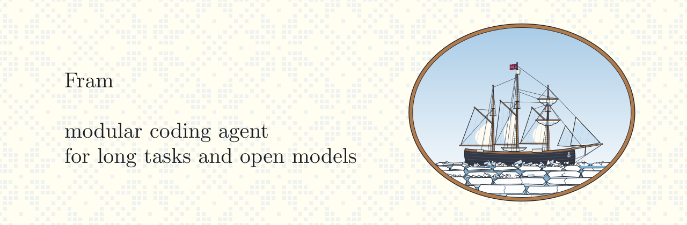

<p align="center">
  
</p>

<p align="center">
  <strong>A modular, hackable terminal coding agent built for long-running tasks and local models.</strong>
</p>

<p align="center">
  <a href="https://github.com/choongng/fram">GitHub</a>
  ·
  <a href="https://twotimespi.dev/">Tau documentation</a>
</p>

---

## What is Fram?

Fram is a coding agent similar to Claude Code, [Pi](https://pi.dev), or
[Tau](https://github.com/huggingface/tau) (on which it is based). It is intended
to perform well out of the box on complex and long-running tasks across a range
of open models, incorporating accumulated lessons about effective context
management, and how to mitigate the failure modes of small and locally hosted
models. Philosophically, given a user directive Fram should continue to execute
against that until successful, avoiding or recovering from any faults it
encounters.

Hackability is a primary goal, Fram is written in Python and structured as a
contributing fork of Tau, maintaining Tau's repo layout and conventions. If you
want to extend it with your own memory, steering, or other integrations it
should be easy to do so.

## Install

Fram needs Python 3.12 or newer. Install it as its own tool with
[`uv`](https://docs.astral.sh/uv/):

```bash
uv tool install fram-agent
fram --version
```

The distribution is `fram-agent` because the shorter name `fram` is taken on
PyPI by an unrelated project. The command is still `fram`, and `fram --version`
names the Tau release it is based on.

Fram bundles Tau's own packages (`tau_ai`, `tau_agent`, `tau_coding`) under
their usual import names, so Tau extensions keep working. Because of that, it
replaces `tau-ai` in any environment it is installed into. Installing it as a uv
tool keeps it in an environment of its own.

Upgrade with:

```bash
uv tool upgrade fram-agent
```

(`fram update` is not currently supported, because Tau's updater would install
`tau-ai`. `fram update --models` still refreshes the model catalogs.)

Fram keeps its configuration and sessions in `~/.fram`. Set `TAU_HOME` to use
another folder, including Tau's `~/.tau`. Project `.tau/` folders are shared
with Tau.

## Quickstart

Run Fram from the project you want it to work on:

```bash
cd my-project
fram
```

Connect a model provider the first time with `/login`, choose a model with
`/model`, then type a request and press **Enter**:

```text
explain what this project does
```

One-shot print mode is useful for scripts and quick prompts:

```bash
fram -p "summarize the architecture"
fram --cwd /path/to/project -p "find the CLI entry point"
```

Fram supports the same providers as Tau: OpenAI, Anthropic, OpenAI Codex
subscription auth, OpenRouter, Hugging Face, and custom OpenAI-compatible
endpoints, including local models. See Tau's [providers
guide](https://twotimespi.dev/guides/providers-and-models/).

## The name

*Fram* is Norwegian for *forward*. It is the name of an [exploration
ship](https://en.wikipedia.org/wiki/Fram_(ship)) engineered to manage crushing
polar ice through careful geometry, rather than trying to fight the forces
directly.

## License

Fram is released under the [MIT
License](https://github.com/choongng/fram/blob/main/LICENSE).
